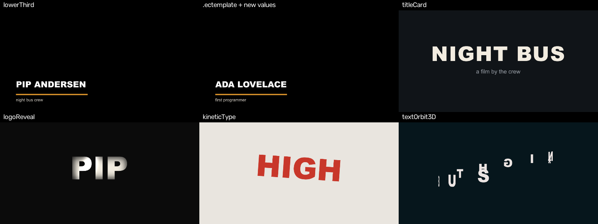
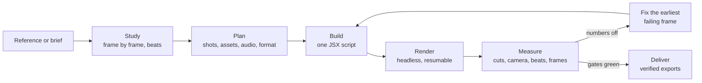

<div align="center">


# effectcraft-editor

**An agent skill that makes motion-design edits in [EffectCraft](https://github.com/storytold/effectcraft) — and checks them with numbers, not vibes.**

Cut real footage, recreate a reel shot for shot, edit to the beat, drop in titles and lower thirds,
composite characters into photos, render photoreal 3D sets, and deliver in any format.

[](LICENSE)
[](CHANGELOG.md)
[](tests/RESULTS.md)
[](tests/RESULTS.md)
[-e87d0d)](scripts/blender)

[Quickstart](#-quickstart) · [What it does](#-what-it-does) · [How it works](#-how-it-works) · [Toolbox](#-toolbox) · [Compare](#-how-it-compares) · [Docs](#-docs)

<br>



<sub>Six templates rendered headless by the test suite. The second panel is the lower third exported as an <code>.ectemplate</code> and re-rendered with new text — no script.</sub>

</div>

---

## 💬 Try saying

> *"Recreate this reel in EffectCraft, down to the camera moves."*
>
> *"Cut these 12 clips into a 30-second montage on the beat, match their colours, and make a vertical version."*
>
> *"Make a 15-second vertical edit in the style of this video, cut to this song."*
>
> *"Add a lower third for each speaker and export ProRes with alpha for my editor."*
>
> *"This shot looks like a PNG pasted on a photo — fix the compositing."*

The skill tells your agent how to plan the edit, which EffectCraft quirks to avoid, which tool measures what,
and when to stop tuning and rebuild a shot instead.

## ⚡ Quickstart

```bash
# 1. get the skill (Claude Code loads skills from ~/.claude/skills)
git clone https://github.com/hamgarian/effectcraft-editor ~/.claude/skills/effectcraft-editor
cd ~/.claude/skills/effectcraft-editor

# 2. Python tools
pip install opencv-python numpy pillow pytest certifi

# 3. find EffectCraft (or save its path once: python scripts/ec_cli.py --set /path/to/effectcraft-cli)
python scripts/ec_cli.py

# 4. check the machine (ffmpeg, Blender, voices) — prints the fix for anything missing
python scripts/doctor.py

# 5. prove it works here
python -m pytest tests -q
```

You need **Python 3.10+**, **ffmpeg/ffprobe** on PATH and **[EffectCraft](https://github.com/storytold/effectcraft/releases)**
(found automatically in the usual folders; your agent asks you for the path if not). Blender is optional (photoreal sets).
Per-OS steps and MCP setup: [`references/setup.md`](references/setup.md).

## ✨ What it does

<table>
<tr>
<td colspan="2" valign="top">

**✂️ Edit real footage**<br>
Probe and conform clips (variable frame rate and black-rendering codecs flagged), find shots, cut the pauses out of a
talking head, build beat-synced montages, then assemble with trims, slips, speed ramps, freezes, reverses, J/L cuts,
punch-ins, picture-in-picture and split screens. Colour-match clips to each other, reframe for vertical by following
the subject, duck the music under speech. Every time helper is checked frame-accurately against rendered pixels.

</td>
</tr>
<tr>
<td width="50%" valign="top">

**🎯 Match a reference**<br>
Study it frame by frame, then measure your render against it: cut timing, camera zoom/roll/pan per shot,
brightness, beats, exposed edges, one-frame glitches, per-frame MAE/SSIM, frames that lead or lag.
Claims are capped by [fidelity levels](references/fidelity.md) — no "pixel perfect" without proof.

</td>
<td width="50%" valign="top">

**🎬 Direct an original edit**<br>
One moving idea, a beat table where every beat changes state, a slideshow check.
Like a video's *style*? `stylemap.py` turns it into a shot-by-shot plan — rhythm, camera, palette — for new content.

</td>
</tr>
<tr>
<td valign="top">

**🎵 Cut to the music**<br>
Tempo, beats and hits from any track; original sound effects (whoosh, impact, riser, click…);
mix, mux, and a check that cuts land on beats and the audio is in sync.

</td>
<td valign="top">

**🧩 Templates with controls**<br>
Lower third, title card, logo reveal, kinetic type, 3D text orbit, social reframe — each exportable as an
`.ectemplate` that renders new text from a JSON file.

</td>
</tr>
<tr>
<td valign="top">

**🧪 Compositing that holds up**<br>
Cut-outs graded into the plate with light wrap, backlit shading and real shadows; motion tracking,
masks and expressions as one-line helpers.

</td>
<td valign="top">

**🧊 Photoreal 3D sets**<br>
Headless Blender (Cycles, HDRI, sun, off-screen shadow casters, smudged glass, screens that take shadow),
rendered and placed back in the edit — for when "make it a real 3D scene" is the note.

</td>
</tr>
<tr>
<td valign="top">

**📦 Deliver anywhere**<br>
MP4, ProRes 4444 + alpha, WebM + alpha, GIF, RGBA PNG, Lottie, and editable timelines for
Premiere, Resolve and Final Cut — each file verified after export. Vertical/square formats with safe areas.

</td>
<td valign="top">

**🗣️ Captions & narration**<br>
Timed captions (SRT, VTT, burned-in) from a script, the beat, or Whisper; offline narration with built-in voices;
stock stills/video from Wikimedia Commons with licences attached.

</td>
</tr>
</table>

## 🔁 How it works



Every edit is a script you can rerun, so a fix is a code change, not a pile of manual tweaks. When tuning stops
moving the numbers for two rounds, the skill says to **rebuild the shot's structure** instead.

## 📊 Proof

From a real reel recreation (logs from the project, not rerun for this repo):

| | before | after | reference |
|---|---|---|---|
| grid camera zoom | 0.45x | **0.71x** | 0.70x |
| dive camera zoom | 0.85x | **1.00x** | 1.00x |
| intro letterbox | 0 px | **104 px** | 104 px |
| frames flagged for wrong brightness | 18 | **0** | — |

On a second reel, `framemetrics.py` picked out the weakest stretch on its own (f174–179, a macro push that stops short) —
the same shot a separate AI review flagged — and `audio.py` read the music at **139.7 BPM** with 26 of 47 cuts on a beat.
Test runs: [`tests/RESULTS.md`](tests/RESULTS.md) (62 passing on EffectCraft 0.16.0; 0.14.0 and 0.16.0 render bit-identical).

## 🧰 Toolbox

<details>
<summary><b>Measure</b> — compare a render with a reference</summary>

| Script | Answers |
|---|---|
| `probe.py` | same size, fps, frame count, duration? (+ SHA-256 of deliveries) |
| `framestudy.py` | labelled frame grids, letterbox size, eyedropper colours |
| `framecmp.py` | cut times and brightness/colour per 0.5 s |
| `framemetrics.py` | every frame: MAE/PSNR/SSIM, worst frames, cut boundaries, lead/lag, codec noise floor |
| `camtrack.py` | camera zoom / roll / pan per shot |
| `glitchfind.py` · `edgeblack.py` · `joincheck.py` | one-frame pops · black borders · bad seams after re-renders |

</details>

<details>
<summary><b>Edit footage</b> — prep, analysis, and the editing helpers</summary>

| Tool | Does |
|---|---|
| `footage.py probe` · `conform` · `normalize` | flag VFR / unsupported codecs · frame-accurate copies, proxies, LUT bake · loudness |
| `footage.py scenes` · `silences` · `beatcut` | shots in a long take · talk without the pauses · one clip per beat |
| `footage.py colormatch` · `reframe` | Levels + 3D LUT to match a reference · subject-following vertical crop |
| `jsx/footage.jsx` | `assemble` with 6 transitions, `slip`, `setSpeed`, `speedRamp`, `freezeFrame`, `reverseClip`, `jCut`/`lCut`, `duck`, `punchIn`, `kenBurns`, `pip`, `splitScreen`, `applyReframe`, `matchColor`, `look`, `filmLook` |

</details>

<details>
<summary><b>Make</b> — audio, assets, captions, style</summary>

| Script | Does |
|---|---|
| `audio.py` | beats & hits, SFX bank, mix, mux, cut-to-beat check, loudness/sync check |
| `stylemap.py` | a reference's shots, camera, palette and energy as a beat table |
| `captions.py` · `tts.py` | timed SRT/VTT/JSX captions · offline narration |
| `title_art.py` · `cutwhite.py` · `stock.py` | titles on generated art · clean cut-outs · licensed stock search |
| `blender/` | photoreal sets (`kit.py`, `phone_on_desk.py`) |

</details>

<details>
<summary><b>Build & ship</b> — scripts, rendering, delivery</summary>

| File | Does |
|---|---|
| `jsx/helpers.jsx` | keys with measured eases, safe property lookup, strict effects, masks, expressions, tracking, captions, compositing |
| `jsx/templates.jsx` | six templates, Essential Graphics controls, formats and safe areas |
| `bundle.py` · `bracecheck.py` · `fxprobe.jsx` | inline includes · catch comment-eaten braces · check effect names |
| `render_seq.py` | one frame per process, resumable, any OS |
| `export.py` | 12 delivery presets, each verified |
| `doctor.py` · `ledger.py` | setup check · run ledger for crash recovery |

</details>

## 🆚 How it compares

<details>
<summary>Feature comparison with other EffectCraft and video-agent skills (checked 2026-10-23 from their READMEs and skill files, not run)</summary>

| | **this skill** | [Pluviobyte](https://github.com/Pluviobyte/video-production-skills) | [full-aigc](https://github.com/full-aigc-skills/effectcraft-skills) | [Vinciux99](https://github.com/Vinciux99/effectcraft-claude-skill) | [jhonsu01](https://github.com/jhonsu01/effectcraft-mcp-server) |
|---|---|---|---|---|---|
| engine | EffectCraft + Blender | HyperFrames / Remotion | EffectCraft | EffectCraft | EffectCraft (MCP) |
| edit real footage (cut lists, speed ramps, J/L cuts, colour match, reframe) | ✅ | — | footage import | — | trim, speed, effects |
| reference recreation + every-frame metrics | ✅ + camera per shot | ✅ | — | — | — |
| fidelity levels, report, motion catalog | ✅ | ✅ | delivery checks | — | — |
| original edits / reference style | ✅ | ✅ | genre skills | — | — |
| templates with controls | ✅ 6 | 2 | 8 | — | ✅ 8 |
| beats, cut sync, SFX, mix | ✅ | partial | — | — | audio layers |
| captions, narration, stock | ✅ | — | — | — | — |
| exports incl. alpha, Lottie, timelines | ✅ verified | MP4 | ✅ | recipes | ✅ |
| tracking, masks, expressions | ✅ | n/a | ✅ | recipes | expressions |
| compositing & photoreal 3D rules | ✅ | — | screen composite | — | — |
| setup check, crash recovery | ✅ | — | ✅ | setup scripts | installer |

Ideas from these projects were rewritten, not copied — see [`CHANGELOG.md`](CHANGELOG.md).
full-aigc's set also has a skill named `effectcraft-editor`; install one of them under another folder name.

</details>

## 📚 Docs

| Read | When |
|---|---|
| [`SKILL.md`](SKILL.md) | the workflow your agent follows |
| [`references/rules.md`](references/rules.md) | compositing, 3D, assets, motion — rules learned from real misses |
| [`references/quirks.md`](references/quirks.md) | EffectCraft scripting traps and their workarounds |
| [`references/footage.md`](references/footage.md) | editing real clips: prep, finding material, helpers, editing rules |
| [`references/director.md`](references/director.md) · [`audio.md`](references/audio.md) · [`formats.md`](references/formats.md) · [`assets.md`](references/assets.md) | planning an edit, music, delivery, art |
| [`references/fidelity.md`](references/fidelity.md) · [`components.md`](references/components.md) · [`report-template.md`](references/report-template.md) | what you may claim, proven motions, the running report |
| [`references/operating.md`](references/operating.md) · [`setup.md`](references/setup.md) | driving EffectCraft from an agent, installing |

## ⚠️ Limits

- Tested on Windows x64 (EffectCraft 0.16.0 and 0.14.0, Blender 5.0). macOS/Linux steps follow EffectCraft's docs but weren't run.
- EffectCraft can't load After Effects plug-ins (`.aex`); AE `.jsx` scripts mostly run.
- With original art, MAE/SSIM aren't pass marks — use them for cuts, lead/lag and worst frames.
- Beat detection is a classic spectral-flux tracker: great for pop/electronic, weaker on rubato or ambient music.
- Safe areas are common margins, not platform specs. No CapCut draft export (use FCP XML / OTIO).
- `footage.py reframe` uses OpenCV's face detector when the installed build has it, else it follows motion.

## 📄 License

[MIT](LICENSE). Originated in a series of reel recreations with original art; no third-party characters, logos,
lyrics or music are included.
